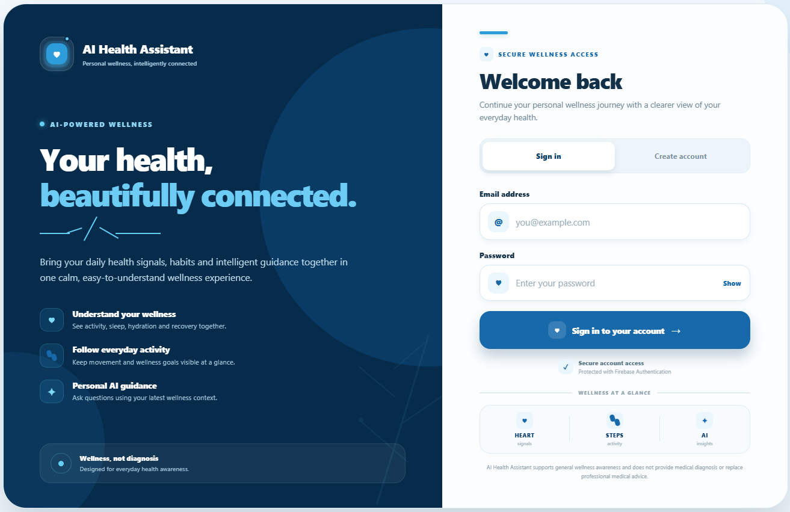
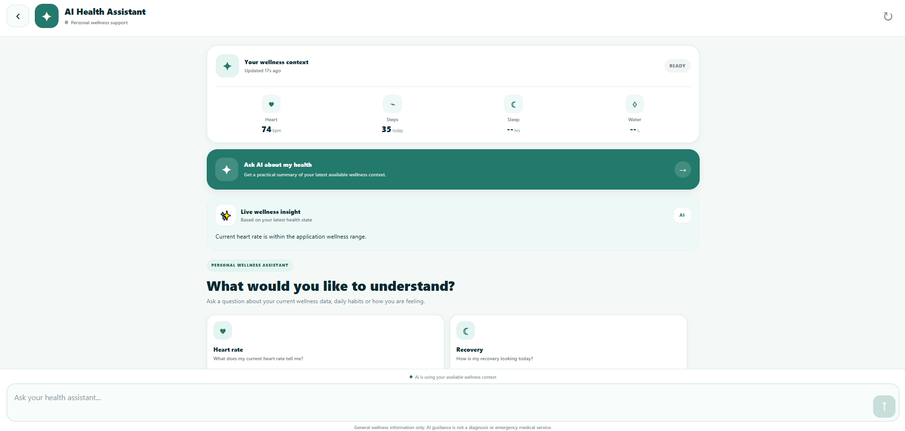

# 🩺 PulseWell – AI-Powered Personal Health Assistant

PulseWell is a full-stack, AI-driven personal health assistant designed to aggregate daily health metrics, provide intelligent wellness context, and deliver interactive AI health recommendations tailored to individual user trends.

---

## 🚀 Key Features

* **Realtime Health Tracking:** Monitor daily step counts, resting heart rate, sleep duration, active calories burned, and water intake.
* **AI Health Assistant Chatbot:** Interactive conversational interface providing context-aware guidance powered by Gemini AI and LLM API integrations.
* **Smart Health Recommendations:** Automated health insights based on historical metrics and daily check-in notes.
* **Secure Authentication:** Firebase Authentication integrated with a PostgreSQL backend for secure, multi-user data isolation.

---

## 📸 Screenshots & Architecture

### **1. System Architecture Diagram**

*(High-level overview connecting the React Native mobile/web app, Express backend, PostgreSQL database, and Gemini/LLMsRelay AI layer.)*

### **2. Mobile & Web UI Dashboard**

*(Main health tracking dashboard showing realtime health metrics and check-in statuses.)*

### **3. AI Health Assistant Chat**

*(Conversational interface leveraging user health context for safe, personalized guidance.)*

---

## 🛠️ Tech Stack

### **Frontend (Mobile & Web)**
* **Framework:** React Native / Expo Go (React Native Web)
* **Navigation:** React Navigation
* **State & Storage:** React Context API, Async Storage
* **HTTP Client:** Axios / Native Fetch API

### **Backend (API Server)**
* **Runtime & Framework:** Node.js, Express.js
* **Database:** PostgreSQL with `pg` connection pool
* **Authentication:** Firebase Admin SDK & Firebase Auth
* **AI Integration:** Google Gemini API (`@google/genai` / LLMsRelay)

---

## 📁 Repository Structure

```text
coit20273-health-assistant/
├── backend/                # Express.js REST API
│   ├── config/             # Database & Firebase setup
│   ├── middleware/         # verifyToken & auth middleware
│   ├── routes/             # API endpoints (healthData, chatbot, users)
│   └── server.js           # Entry point
├── mobile/                 # Expo React Native App
│   ├── src/
│   │   ├── components/     # UI components & forms
│   │   ├── navigation/     # Navigation stacks
│   │   ├── screens/        # Dashboard, Health, Chatbot, Profile
│   │   └── services/       # apiClient, authService, apiService
│   └── App.js              # Mobile entry point
├── database/               # Schema migrations & seed data
└── docs/                   # Project documentation & assets
```
## 🚦 Getting Started

### Prerequisites
* **Node.js** (v18 or higher)
* **PostgreSQL** database instance
* **Expo Go** app on a mobile device OR a web browser (Microsoft Edge / Google Chrome)

---

### 1. Backend Setup

1. **Navigate to the backend directory:**
   ```bash
   cd backend
   ```
2. **Install backend dependencies:**
   ```bash
   npm install
   ```
3. **Create a .env file inside the backend/ directory with the following configuration:**
   ```Code snippet
   PORT=3000
   PGHOST=localhost
   PGPORT=5432
   PGDATABASE=pulsewell_db
   PGUSER=your_postgres_user
   PGPASSWORD=your_postgres_password
   LLMSRELAY_API_KEY=your_llm_api_key
   ```
4. **Start the development server:**
   ```bash
   npm run dev
   ```
### 2. Mobile / Frontend Setup
1. **Navigate to the mobile app directory:**
   ```bash
   cd mobile
   ```
2. **Install frontend dependencies:**
   ```bash
   npm install
   ```
3. **Configure environment variables:**
Create or edit the .env file inside mobile/:
   ```Code snippet
   EXPO_PUBLIC_API_BASE_URL=http://localhost:3000
   ```
4. **Launch the Expo development client:**
   ```bash
   npx expo start
   ```
- Press w to open in your web browser (Microsoft Edge / Chrome).
- Press a for Android Emulator or i for iOS Simulator.
- Scan the displayed QR code using the Expo Go app on a physical iOS or Android device.

---

## 🔗 Key API Endpoints

| Method | Endpoint | Description | Auth Required |
| :--- | :--- | :--- | :--- |
| `POST` | `/api/v1/health` | Save daily health metrics | Yes (`Bearer Token`) |
| `GET` | `/api/v1/health` | Retrieve authenticated user's metrics history | Yes (`Bearer Token`) |
| `POST` | `/api/v1/chatbot/message` | Send message to AI Assistant with health context | Yes (`Bearer Token`) |
| `GET` | `/api/v1/users/me` | Fetch active user profile details | Yes (`Bearer Token`) |

---

## 👥 Authors & Team Members

* **Anthony Sutan Lie** – Backend Architecture, Database & API Integration
* **Sakshi Saini** – Backend Routes & User Management
* **Prathyusha Biradar** – Frontend UI & Realtime Integration